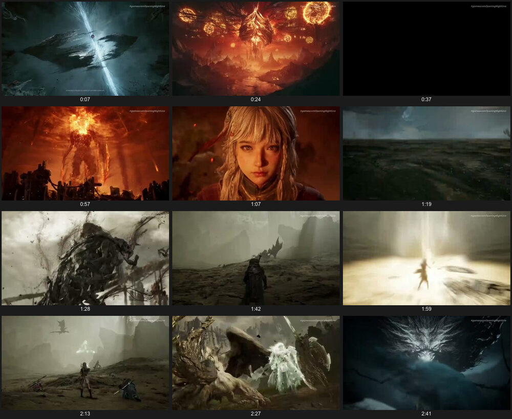
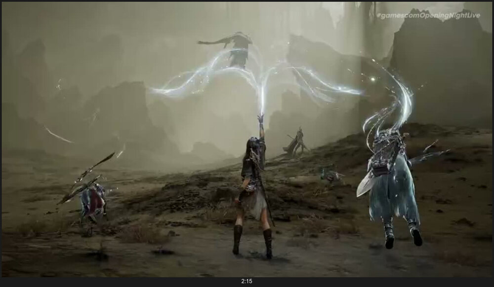

# watchvideo

把一条视频变成模型能读的东西：**字幕**和**一张印相样片**。不留视频文件。

*Turn a video into something a model can actually read: **subtitles** and a single
**contact sheet**. No video file is kept.*

```bash
watchvideo <url>              # 字幕 + 样片，一次给全   subtitles + contact sheet
watchvideo <url> --no-frames  # 只要字幕                subtitles only
watchvideo <url> --list       # 先看有哪些字幕轨        list available tracks
watchvideo <url> -H           # 读烧在画面里的硬字幕    read burned-in subtitles
```

## 长什么样 / What it looks like

一条 2:52 的游戏预告片，12 格排成 3×4，每格 520px——烧录字幕和角色细节都还读得出：

*A 2:52 game trailer as 12 cells in a 3×4 grid, 520px each — burned-in captions and
character detail both survive:*



## 为什么不直接用 yt-dlp / Why not just yt-dlp

小红书（RedNote）的视频带真的 srt 字幕轨（`sns-subtitle-s2.xhscdn.com`，常见
`zh-CN` / `en-US` / `source` 三条），但 yt-dlp 的 `xiaohongshu.py` 里**一行字幕代码都没有**，
只会回一句 `has no subtitles`。那不是"站上没有"，是"工具没做"。这里自己从页面 JSON 解析。

*Xiaohongshu (RedNote) videos do carry real srt subtitle tracks, but yt-dlp's
`xiaohongshu.py` contains **no subtitle code at all** — it just says
`has no subtitles`. That is not evidence the site lacks them; it means the
extractor never implemented them. This tool parses them out of the page JSON.*

两个坑：小红书**必须匿名抓**——带登录 cookie 时它返回的是另一套残缺页面，既没有字幕块
也没有可下载的 video format；解析时只还原 `/`、`&`、`\"` 三种转义，别整篇
`unicode_escape`，那会毁掉中文。

*Two traps: you **must fetch anonymously** — with login cookies the site returns a
different, stripped-down page carrying neither subtitles nor any downloadable video
format. And unescape only `/`, `&` and `\"`; a blanket `unicode_escape` will destroy CJK text.*

## 为什么样片要拼成一张 / Why one sheet instead of N images

因为逐张递图给模型，模型会**跳着看**。

*Because when you hand a model N separate images, it **skips some of them**.*

这个工具的起因是一次失败：23 帧逐张读进去，模型自己挑着看、跳过了其中 5 张，而唯一能
认出画面里那个人是谁的关键帧，正在被跳过的那几张里。抽帧质量没问题，问题在呈现——
N 张孤立的图片没有时序关系，注意力还会随张数衰减。

*This tool started from a failure: 23 frames were read in one by one, the model picked
which ones to look at, skipped 5 of them — and the only frame that identified the person
on screen was among the skipped ones. The extraction was fine; the presentation was not.
N isolated images carry no temporal relationship, and attention decays across them.*

拼成一张网格、每格标时间戳，模型没法跳帧，还能一眼看到时间线。需要细节时再按时间戳
单独放大那一格。

*Tiled into one grid with a timestamp under each cell, nothing can be skipped and the
timeline is visible at a glance. Zoom into a single cell by timestamp when you need detail.*

## 先总览，再放大 / Survey first, then zoom

样片是用来**定位**的，不是用来看细节的。挑出可疑的格子之后，用 `-z` 按时间戳把
那一瞬间抽成大图（单帧给到 1400px）。

*The sheet is for **locating**, not for detail. Once a cell looks interesting, `-z`
pulls that exact moment out at full size (1400px for a single frame).*

```bash
watchvideo <url> -F          # 哪一格可疑？        which cell looks interesting?
watchvideo <url> -z 2:15     # 把它抽出来看清楚     pull it out and look properly
```

这个工作流是有实际代价的教训。上面那张样片里 2:13 那格，看着像"持剑者与跪着的人
对峙"。放大之后：

*This workflow came from getting it wrong. In the sheet above, the cell at 2:13 looked
like "a swordsman facing someone kneeling". Zoomed in:*



五个角色各打各的位——那不是对峙，是多人同屏。缩略图能告诉你哪里值得看，
但不足以让你断定看到了什么。

*Five characters spread across the field — not a standoff, a co-op party. Thumbnails
tell you where to look; they are not enough to conclude what you saw.*

## 关于格数 / On the number of cells

格数按时长打底（≤15s→6，≤45s→8，≤3min→12，更长→16），**再按实际镜头数取大**，
上限 40 格；`-F N` 可以显式指定。

*Cell count starts from duration (≤15s→6, ≤45s→8, ≤3min→12, longer→16), then takes
**whichever is larger: that, or the number of detected shots**, capped at 40.*

只看时长会漏掉一大半。一条 172 秒的预告片有 35 个镜头，按时长只给 12 格——出品方
logo 那一格就没抽到（黑场抽到了，logo 亮起的下一格没有），骑乘、沼泽、深海全不见。
反过来 20 秒的单镜头视频给 12 格纯属浪费。两者取大才对。

*Duration alone misses most of it: a 172-second trailer holds 35 shots, and 12 cells
skipped the publisher's logo entirely — along with whole biomes. Meanwhile a 20-second
single-shot clip does not need 12.*

格数多到一张放不下时会**自动分成多张**（`.sheet-1.jpg`、`.sheet-2.jpg`），每格保证
不小于 350px。一张 40 格的样片缩放后每格只剩 229px，那个尺寸能看出"有什么"、
看不出"是什么"；分成两张之后每格 390~464px，翻了一倍。按像素卡而不是按格数，
是因为同样 20 格横屏有 390px、竖屏只剩 220px。

*When the cells no longer fit on one image it **splits into several**
(`.sheet-1.jpg`, `.sheet-2.jpg`), keeping every cell at 350px or more. A single 40-cell
sheet shrinks to 229px per cell — enough to see that something is there, not enough to
tell what it is. Split in two, each cell is 390–464px. The threshold is in pixels rather
than cell count because the same 20 cells give 390px landscape but only 220px portrait.*

**别指望用帧间差异去重来解决冗余。** 拿真实样本量过：一条水面拍摄的海獭视频（20 秒
单镜头，冗余最重）和一条室内固定机位的水獭视频，归一化 RMSE 中位数分别是 0.176 和
0.094——冗余最重的那条反而全程更高，因为波光让每帧像素差都很大。换感知哈希 PHASH，
两条几乎重合（2.01 vs 2.30）。像素和感知距离只能回答"画面变了没有"，回答不了
"意思重复了没有"。所以去重只用来清掉肉眼全等的帧，真正控制冗余的是格数。

实测这个分工很清楚：快切的预告片候选 70 帧、去重后剩 56（清掉两成，都是同一镜头
被抽到两次）；而单镜头的水獭视频候选 12 帧、**一帧都去不掉**——它确实一直在动，
只是动作语义重复。去重管"抽重了"，格数管"这片子本来就没那么多信息"。

*The division of labour is measurable: on a fast-cut trailer 70 candidates dedupe down to
56 (a fifth removed, all of them the same shot sampled twice); on a single-shot otter clip
12 candidates dedupe to **12 — nothing removed at all**. The otter really is moving the
whole time; only the meaning repeats. Dedup handles double-sampling, cell count handles
clips that simply hold less.*

***Do not expect frame-difference dedup to solve redundancy.*** *Measured on real samples:
a sea otter filmed on water (20s, single shot, the most redundant clip) versus an otter
indoors on a fixed camera — median normalised RMSE 0.176 vs 0.094. The **most** redundant
clip scores **higher** throughout, because rippling water keeps every pixel delta large.
Perceptual hashing barely separates them either (median PHASH 2.01 vs 2.30). Pixel and
perceptual distance answer "did the picture change", not "did the meaning repeat".
So dedup only removes visually identical frames; cell count is what actually controls redundancy.*

### 抽帧的四条毛边（20260828 一次性修掉）

**黑屏帧会被扔掉、往后挪一点重抽。** 讲解片常有整段黑底配字幕，那种格子在样片上
就是一块白扔掉的黑。判据是**上 70% 的灰度标准差**——必须避开底部字幕带：连字幕
一起算，纯黑帧是 19.9，跟真画面贴上了；只看上 70% 是 5.2，而**昏暗但有内容**的
真画面（夜戏荒原、暗色 UI）低到 17.5。阈值取 10，卡在这条空档中间。

**去重跟每一张已留下的帧比，不再只跟上一张。** 实测有两格隔了 4 分钟的同一张图，
PHASH 0.24——**本来就在 0.35 阈值以下**，只是中间隔了十几帧，从来没被拿来比过。
阈值一个字没改，改的是比谁。为了不把 O(n²) 次 `compare` 真跑出来（190 对要 15 秒，
6 分钟的片子要 4 分钟），先用 8×8 灰度签名粗筛：190 对里只放行 3% 进 PHASH，
0.5 秒。粗筛只挡"明显不同"，不当判据——它跟 PHASH 不同序。**190 对暴力验证过：
真重复一对都没漏。**

**挨得太近的切点先合并（1 秒内算同一镜头）。** 镜头**内部**的快速运镜会让 scene
detect 连报几刀——实测同一个镜头里 0:48.0 和 0:48.3 报了两刀，于是"每切点一帧"
变成同一镜头抽三帧。合并之后再按"切点不复用"选，一个切点一个镜头。

**样片标签带一位小数，抽帧让开切点 0.3 秒。** 标签以前截断到整秒，而选帧落在切点上、
切点很少在整秒——19.9 秒那一帧标成 `0:19`，照着敲 `-z 0:19` 会 seek 到 19.0、
落在上一个镜头里。标签是给人抄回去用的，就得抄得回去。让开 0.3 秒是躲开刀口上的
叠化/黑场过渡帧。

*Four rough edges fixed together (2026-08-28): blank frames are detected on the **top 70%**
only (burned-in subtitles lift a pure-black frame's stddev to 19.9, colliding with real
footage; the top 70% gives 5.2 for black and 17.5 for the darkest real frame — threshold 10)
and re-sampled a little later. Dedup now compares against **every** kept frame rather than
only the previous one — a pair four minutes apart scored PHASH 0.24, already under the 0.35
threshold, and had simply never been compared; an 8×8 grey signature prefilters so only 3%
of pairs reach the expensive `compare` (validated against all 190 pairs: no true duplicate
skipped). Scene cuts closer than 1s are merged, since camera movement **inside** one shot
makes the detector fire repeatedly. Labels carry one decimal and extraction leads the cut by
0.3s, so a label can be pasted straight back into `-z`.*


## 安装 / Install

```bash
brew install yt-dlp ffmpeg imagemagick     # macOS
```

要 `-H`（读硬字幕）还得装一点东西，见下面「装 -H」。*`-H` needs a little more; see "Setting up `-H`" below.*

Linux 用各自的包管理器装这三个即可。把 `watchvideo.py` 放进 PATH（或做个软链）。

*On Linux install the same three via your package manager. Put `watchvideo.py` on your PATH.*

## 用法 / Usage

```bash
watchvideo <url>                   # 字幕 + 样片（默认）    subtitles + sheet
watchvideo <url> --no-frames       # 只要字幕              subtitles only
watchvideo <url> -f srt            # 要时间轴              keep timestamps
watchvideo <url> -l zh-CN          # 指定语种              pick a language
watchvideo <url> -F 20             # 显式给格数            explicit cell count
watchvideo <url> -z 2:15           # 放大某个时间点        zoom into one moment
watchvideo <url> -z 2:11,2:13,2:15 # 放大多个时间点        several moments
watchvideo <url> -o DIR            # 输出目录              output directory
watchvideo <url> --browser chrome  # 借浏览器 cookie       borrow browser cookies
watchvideo <url> -H                # 硬字幕 + 样片         burned-in subs + sheet
watchvideo <url> -H -f srt         # 硬字幕带时间轴        ... with timestamps
watchvideo <url> -H --ocr vision   # 两行字幕/多行花字     multi-line captions
watchvideo <url> --keep-ads        # B 站不剃恰饭段        keep Bilibili sponsor segments
watchvideo ./clip.mp4              # 本地文件也行          local files work too
```

环境变量 `WATCHVIDEO_OUT` / `WATCHVIDEO_BROWSER` 可以省掉每次输入。
⚠️ `WATCHVIDEO_OUT` **会改掉产物的落点**（默认是当前目录）——设了之后东西不在
你跑命令的地方。跑完那行 `-> ` 打的是绝对路径，以它为准；`--help` 里也会显示当前生效值。

*`WATCHVIDEO_OUT` / `WATCHVIDEO_BROWSER` set your defaults. Note that
`WATCHVIDEO_OUT` **relocates the output** (default: current directory) — files
won't be where you ran the command. The `-> ` line prints the absolute path.*

## 0.3 起：两条一起跑 / Since 0.3: both paths by default

0.2 及之前，`-F` 的意思是「拼样片，**而且不抓字幕**」——两条路互斥，一次只能要一样。

**这不是加了个新默认，是把文档早就在教的事挪进了代码。** 本文件「已知限制」那一节
从发布起就写着：*ASR 会听错专名……要紧的视频，字幕和样片两条都跑。* 文档让你手动做的事，
工具却设成了二选一。而且这个项目叫 `watchvideo` 不叫 `getsubs`——**只给文字，本来就没兑现名字。**

⚠️ **但这确实是行为变更，不是纯粹的增补**：默认路径现在会**下载整个视频**来抽帧，
比只拉字幕慢一个数量级，还会多产一个 `.sheet.jpg`。把它写进脚本的人明天会觉得变慢了。

- **要旧行为**：`--no-frames`。纯语音的东西（播客、讲座、访谈）抽帧是白抽，用它。
- `--list` 不受影响：那是「问有哪些字幕轨」，不该顺带下一整个视频。
- `-z` 不受影响：那是「样片看过了，我要看某一秒」，独立动作。
- 字幕拿不到但样片拿到了仍算成功（小红书就是这样，yt-dlp 看不见它的字幕轨），反之亦然；两条都塌了才返回非零。

*Through 0.2, `-F` meant "make a sheet **and skip subtitles**" — the two paths were
mutually exclusive. **This release doesn't add a new default so much as move into the code
what the docs already told you to do**: the Known limitations section has said since day one
that for anything that matters you should run both paths. And the project is called
`watchvideo`, not `getsubs` — text alone never quite delivered on the name.*

*It is still a behaviour change: the default path now **downloads the whole video** to
sample frames — an order of magnitude slower than fetching subtitles, plus one extra
`.sheet.jpg`. Use `--no-frames` for the old behaviour (and for audio-only material, where
frames are worthless). `--list` and `-z` are unaffected. If one path fails but the other
succeeds the run still exits 0; only a double failure is an error.*

## 0.4：硬字幕 / Since 0.4: burned-in subtitles (`-H`)

很多视频根本没有字幕轨，或者自动字幕听不懂方言——可 UP 主烧进画面的字是人听懂了打的，是准的。
字已经在画面上，只差读出来。`-H` 把「字幕」那一半换成读画面上的字，**帧照抓**（不要帧加 `--no-frames`）。

*Plenty of videos have no subtitle track, or auto-captions that can't follow a dialect — yet the
captions burned into the picture were typed by someone who understood it. `-H` swaps the subtitle
half for reading those on-screen captions; **frames are still sampled** (`--no-frames` to skip).*

做法：先抽 24 帧找字幕在画面哪一条（找错了用 `--sub-region 0.25` 指定底部比例）→ 相邻帧比差异，
字幕变了才算新的一句 → 每句取中间一帧 → 检测模型先框出字幕行再识别 → 连续相同的合并。
画面里固定不动的字（台标、水印）会被认出来剔掉；句子两头粘上的背景字按单字把握度和字间距剪掉。
23 分钟的视频大约 20 秒。

*How: sample 24 frames to locate the caption band (override with `--sub-region 0.25`) → diff
adjacent frames so only a changed caption counts as a new line → OCR one frame per line, detecting
the text box first → merge repeats. Static text (logos, watermarks) is dropped; stray background
glyphs stuck to either end are trimmed by per-character confidence and spacing. ~20 s for 23 minutes.*

两个识别引擎：

- **PP-OCRv6 tiny**（默认，[Apache 2.0](https://huggingface.co/PaddlePaddle/PP-OCRv6_tiny_rec_onnx)）：
  识别 4.4MB + 检测 1.8MB，快且准，**只认单行**。实测 69 句 1.6s，Vision 要 4.4s。
- **macOS Vision**（`--ocr vision`）：系统自带，认多行，但**系统性吞「的」**
  （「心心念念的老秦人的坟头」→「心心念念老秦人坟头」）。两行字幕、多行花字时用它。

*Two engines: **PP-OCRv6 tiny** (default; 4.4 MB recogniser + 1.8 MB detector, fast and accurate,
**single line only**) and **macOS Vision** (`--ocr vision`; built in, handles multiple lines, but
systematically drops the particle 的). Locating the caption band always uses Vision, so `-H` is macOS-only.*

### 装 -H / Setting up `-H`

```bash
# 1. Vision 小工具（找字幕位置要用，必装）   the Vision helper (required)
cd /path/to/watchvideo && swiftc -O visionocr.swift -o visionocr

# 2. PP-OCR（可选；没装会自动退回 Vision）   PP-OCR (optional; falls back to Vision)
M=${WATCHVIDEO_MODELS:-~/.cache/watchvideo/models}
python3 -m venv $M/.venv && $M/.venv/bin/pip install onnxruntime numpy pillow pyyaml
for r in rec det; do
  hf download PaddlePaddle/PP-OCRv6_tiny_${r}_onnx inference.onnx inference.yml --local-dir $M/ppocrv6_tiny_$r
done
```

模型目录默认 `~/.cache/watchvideo/models`，`WATCHVIDEO_MODELS` 可以改。
没有 `hf` 命令就 `pip install huggingface_hub`，或者去模型页手动下那两个文件。

*Models live in `~/.cache/watchvideo/models` unless `WATCHVIDEO_MODELS` says otherwise. No `hf`?
`pip install huggingface_hub`, or grab the two files from the model pages by hand.*

## 0.4：样片更会挑格 / Since 0.4: smarter contact sheets

- **每格印台词**：格子下面印那一刻的字幕（硬字幕也算），样片后再打一份「格子台词」文字版。
  画面和台词对上了，不用再拿时间戳去字幕里翻。
- **字幕在指画面时强制抽一帧**：说到「请看」「这张图」「右上角」「look at…」，那一刻一定有一格（标 ★），删格时不删。
- **画面突变进候选**：口播 + 不停弹截图的视频，背景从头到尾不换，镜头检测只认出一个镜头。
  现在每 0.5 秒比一次缩略图，突然变了一大块（截图弹出、换页）就进候选。实测一条这样的视频，有截图的格 9 → 12。
- **删格先删最像的**：格数超了，不再均匀删，一张张删「跟留下的最像的那张」——同一个大头复读六遍的先走。

*Each cell now carries the line being spoken at that moment (plus a text version after the sheet);
a line that points at the picture ("look at…", "top right") forces a frame (★); sudden on-screen
changes (a screenshot popping up over a talking head) become candidates even when scene detection
sees one long shot; and when trimming, the cell most similar to what's kept goes first.*

## 站点 / Sites

样片对 yt-dlp 支持的站点通用；字幕除小红书外也走 yt-dlp。实测过 B 站、小红书、YouTube、X。

*Contact sheets work for anything yt-dlp can download; subtitles go through yt-dlp except
for Xiaohongshu. Tested on Bilibili, Xiaohongshu, YouTube and X.*

- **B 站**的 AI 字幕**必须登录**，要加 `--browser`。刚在浏览器登录完得等几秒再跑：
  Chromium 系 cookie 落盘有延迟，在那之前抽到的是旧登录态，B 站会回一句很误导人的
  `Subtitles are only available when logged in`——那句话跟你登没登其实没关系。

  ***Bilibili*** *AI subtitles require login (`--browser`). Wait a few seconds after logging
  in: Chromium writes cookies to disk lazily, and until it does you get the stale session
  plus a badly misleading `Subtitles are only available when logged in`.*

- **B 站去广告**（20261018）：默认按 [BilibiliSponsorBlock](https://www.bsbsb.top)（「B站空降助手」的社区标注库）
  剃掉恰饭（`sponsor`）和自推（`selfpromo`）段——字幕里落在段内的句子删掉，样片在剃掉广告后的正片时间轴上均匀取格，
  标签仍是原片时刻（`-z` 照用）。片头片尾、三连提醒不剃。运行时会打一行剃了哪几段；**没人标过会明说「没剃」**，
  不代表没广告。不想剃加 `--keep-ads`。

  ***Bilibili ad skipping***: *sponsor and self-promo segments from BilibiliSponsorBlock's community
  database are cut from subtitles and contact sheets by default (labels keep original timestamps).
  Unlabelled videos are reported as such. `--keep-ads` to disable.*

- **YouTube** 的自动字幕里，真 ASR 那条标成 `<lang>-orig`，其余一两百条都是机翻。
  不指定语种时默认只取原生轨，不然会一次落下一百多个文件。

  ***YouTube*** *marks the real ASR track `<lang>-orig`; the other ~150 are machine
  translations. Without `-l`, only the original is taken.*

## 已知限制 / Known limitations

- 小红书那条路靠解析页面里的 `__INITIAL_STATE__`，**页面结构一变就会失效**。这也是为什么
  小红书的字幕支持更应该进 yt-dlp 上游，而不是长期由这里维护。

  *The Xiaohongshu path parses `__INITIAL_STATE__` and **will break when the page changes**.
  This is exactly why that support belongs upstream in yt-dlp rather than here.*

- 样片标签用 ImageMagick 的 `montage -label`，需要系统里有可用字体；找不到就交回给
  ImageMagick 自己的 fontconfig，某些机器上标签可能不渲染。

  *Labels rely on a usable system font; without one, rendering falls back to fontconfig
  and may come out blank.*

- ASR 会听错专名。有次《牛来》被听成「牛奶」，而画面里的硬字幕写得清清楚楚——**两条
  互相校对，这也正是 0.3 起默认两条都跑的原因**（见上一节）。

  *ASR mishears proper nouns. One clip's title was transcribed as "milk" while the burned-in
  caption on screen spelled it out correctly. **The two paths check each other — which is
  exactly why 0.3 runs both by default** (see above).*

## License

MIT
